# How wrong is a Lineweaver-Burk Km?

[](https://github.com/Qwuantabee/enzyme-kinetics/actions/workflows/tests.yml)
[](https://github.com/Qwuantabee/enzyme-kinetics/blob/main/LICENSE)
[](https://github.com/Qwuantabee/enzyme-kinetics/blob/main/pyproject.toml)

**How wrong can a kinetic constant be when the fit ignores how the data were measured?** Two measured answers:

- **Under constant absolute error, a Km spread 3.6× the nonlinear fit's; under proportional error, none.** Lineweaver-Burk's tail-insensitive Km spread (IQR / 1.349) is 59% against 16% for the nonlinear fit over 500 simulated experiments, and 84 of the 500 fits return a negative Km. Its sample SD (6086% against 18.2%) is not a stable number: one fit of the 500 carries most of it. Under proportional error Lineweaver-Burk is as precise as the nonlinear fit (SD 11.1% against 10.3%).
- **A standard error 12× too small.** On a published trace set (P99 β-lactamase, 18 progress curves, 2376 points) the Km standard error a least-squares fit reports is ±0.185 µM; resampling whole traces gives ±2.21 µM, because readings inside one trace are not independent.

That Lineweaver-Burk is unreliable is textbook, not a finding of this repository (Wilkinson 1961, *Biochem J* 80:324; Dowd & Riggs 1965, *J Biol Chem* 240:863). Nothing here is a new result about the plots; what the repository adds is a reproducible measurement of the size of the effect, on a stated design, under two error models.

`enzkin` is the small library behind those numbers: Michaelis-Menten and inhibition fits for initial rates and progress curves, AICc ranking of four inhibition mechanisms, IC50-to-Ki conversion tested against ChEMBL *E. coli* DHFR records, and a descriptor QSAR with a permutation null. Every figure is regenerated from committed data by `python scripts/make_figures.py`.

## At a glance

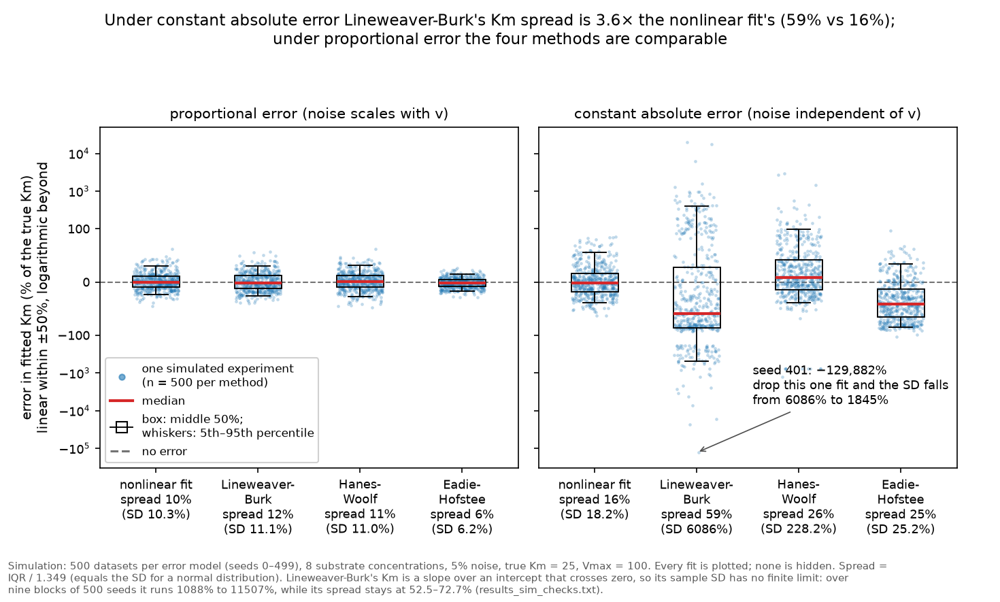

**Under constant absolute error Lineweaver-Burk's Km spread is 3.6× worse than the nonlinear fit's (59% for Lineweaver-Burk against 16% for the nonlinear fit); under proportional error the four methods are comparable** (Km SD 6.2–11.1%, Eadie-Hofstee tightest). The design decides the size: 8 substrate concentrations spaced geometrically from 0.1 to 10 × Km, and a noise SD of 5% of each rate (proportional) or 5% of Vmax (absolute), which is 55% of the lowest true rate. The spread (IQR / 1.349, equal to the SD for a normal distribution) is the number to carry away: it stays at 52.5–72.7% across nine blocks of 500 seeds (`results_sim_checks.txt`). The sample SD printed under each box is not: Lineweaver-Burk's Km is a slope divided by an intercept that crosses zero, so its sampling distribution has no finite variance. On seeds 0–499 it is 6086% against 18.2% for the nonlinear fit; without the single most extreme fit (seed 401, marked in the figure) it is 1845%, and eight further blocks of 500 seeds give 1088% to 11507%. Only these two error models and this one design were run.

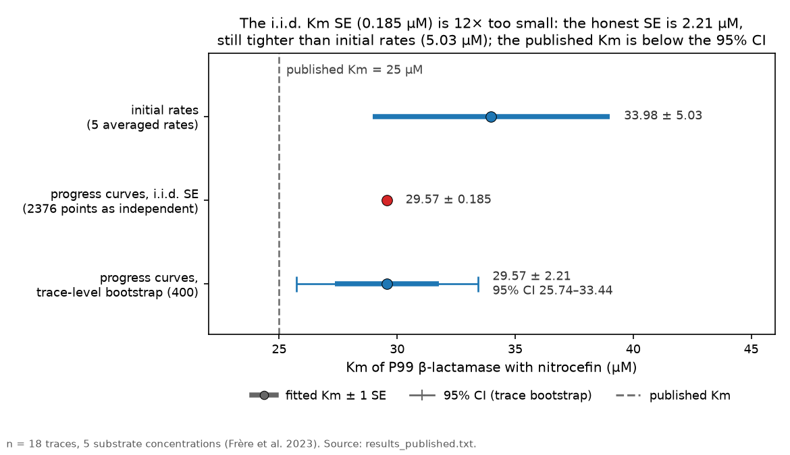

**The i.i.d. Km standard error is 12× too small on this dataset.** Treating 2376 points as independent gives ±0.185 µM; resampling the 18 traces whole (400 resamples, stratified by starting substrate concentration, 2 to 5 traces at each of 5 concentrations) gives ±2.21 µM, still tighter than initial rates (±5.03 µM). The published 25 µM lies just below the 95% interval (25.74–33.44). The factor belongs to this sampling density, not to the method: the i.i.d. SE shrinks with every extra reading per trace and the trace-level SE does not.

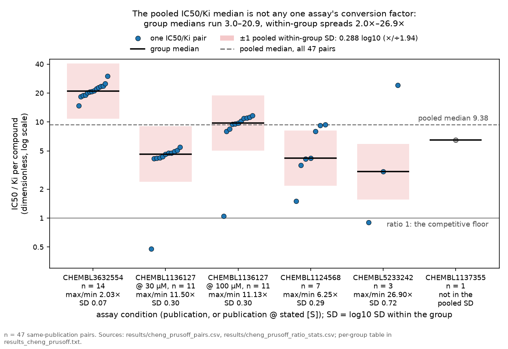

**No single IC50/Ki factor fits.** Same-paper ratios have group medians from 3.0 to 20.9 and within-group max/min spreads of 2.0×–26.9×; the pooled median (9.38) describes none of them. The Cheng-Prusoff form is partially supported; its values are untested.

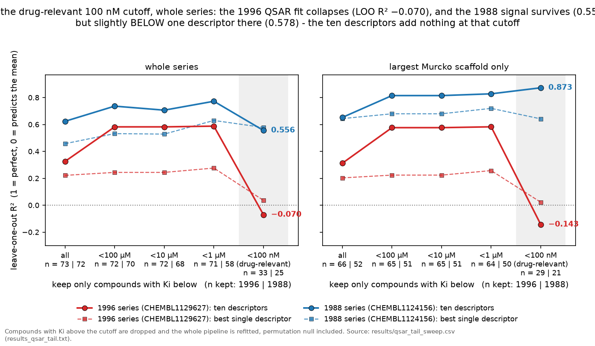

**The structure-affinity signal depends on the potency range.** Keeping only Ki < 100 nM, leave-one-out R² is **−0.070** (n = 33) in the 1996 series and **0.556** (n = 25) in the 1988 series, where one descriptor does as well (0.578).

## Limits, stated plainly

- **The simulation numbers belong to one design.** One substrate grid (8 points, 0.1 to 10 × Km), one noise level (5%), Gaussian noise, two error models. No other grid or noise level was run, so none of the percentages transfers to another assay as a number.
- **The 12× is one dataset.** One enzyme, one substrate, one laboratory, 18 traces. The bootstrap has 18 units in strata of 2 to 5, so its own SE and interval are coarse, and "the published 25 µM lies just below the interval" is not a rejection of the published value.
- **The mechanism table tests four candidates against each other and nothing else.** Competitive, uncompetitive, noncompetitive and mixed; no partial, tight-binding or slow-binding model. The data are simulated with proportional noise and fitted unweighted, 100 experiments per cell.
- **The IC50/Ki comparison rests on 47 pairs from 5 papers**, 22 of them from one paper. Its verdict label depends on a threshold chosen here (0.30), and flips at 0.25.
- **The QSAR describes variation inside series that were already measured.** It is not a prediction for a new compound, and molecular weight alone carries most of it.
- **The ChEMBL tables are a snapshot** fetched by `scripts/fetch_chembl_dhfr.py`; a re-fetch can return different records.

## Why not just use a Lineweaver-Burk plot

The textbook warning, that inverting `v` inflates the error on the low-[S] points and wrecks the regression, held here **under constant absolute error and not under proportional error**. Under proportional error the transforms are fine and Eadie-Hofstee is the most precise, because the reciprocal stabilises proportional variance. 500 simulated datasets per error model (seeds 0–499; 8 substrate concentrations spaced geometrically from 0.1 to 10 × Km; noise SD 5%, of each rate in the first table and of Vmax in the second; true Km = 25, Vmax = 100; figure above):

**Proportional error** (noise scales with the rate):

| method | Km bias | Km SD | Vmax bias | Vmax SD |
|---|---|---|---|---|
| nonlinear fit | +0.8% | 10.3% | +0.3% | 4.3% |
| Lineweaver-Burk | +0.1% | 11.1% | -0.0% | 6.9% |
| Hanes-Woolf | +0.8% | 11.0% | +0.2% | 5.0% |
| Eadie-Hofstee | -1.1% | **6.2%** | -0.5% | 3.5% |

**Constant absolute error** (noise independent of the rate):

| method | Km bias | Km SD | Vmax bias | Vmax SD |
|---|---|---|---|---|
| nonlinear fit | +1.0% | 18.2% | +0.3% | 5.5% |
| Lineweaver-Burk | -318% | **6086%** | -177% | 3302% |
| Hanes-Woolf | +17.6% | 228% | +2.3% | 29.9% |
| Eadie-Hofstee | -23.8% | 25.2% | -12.3% | 10.3% |

Under absolute error the lowest rate is 9.1 against a noise SD of 5, so its reciprocal is what the regression mostly fits; that is the mechanism of the failure, and a design whose lowest [S] sits higher should show less of it (not run). The Lineweaver-Burk bias and SD in the second table are sample moments of a distribution without a finite mean or variance: they reproduce exactly from seeds 0–499 and would be different numbers of the same kind on other seeds.

Which model applies is a property of the assay, not of the algebra: a continuous spectrophotometric read of a small absorbance change is closer to constant absolute error, where Lineweaver-Burk falls apart; a dilution-series or counting assay is usually closer to proportional. The nonlinear fit is the only method whose bias stays near 1% and whose Km SD stays below 20% in both tables, so it is the default; `weights="relative"` switches to proportional-error weighting. (Hanes-Woolf, like the nonlinear fit, is never the worst entry in a column, but its Km SD is 228% under absolute error.)

## Confidence intervals

The first `ci95` used ±1.96·SE and covered the true Km **86.8%** of the time while claiming 95% (proportional-error simulation; 89.4% under constant absolute error, reproduced by swapping 1.96 for the t value on the same 500 fits). With 8 points and 2 parameters (6 degrees of freedom) the critical value is t = 2.45, not 1.96; the t distribution raised coverage to **91.0%** (proportional error) and **93.2%** (absolute error). These are 500 fits each, so every coverage figure carries about ±2 to ±3 points of binomial error: the 93.2% is not distinguishable from 95%, the 91.0% is. The gap that remains is expected rather than a bug: Km and Vmax are bounded below at zero and right-skewed, so no symmetric interval is exact, and under proportional error the fit is unweighted, which the simulation does not separate from the skew. When the SE is a large fraction of the estimate, use `bootstrap_ci` (residual resampling, no symmetry assumption).

## How far up the substrate range you need to go

Median relative standard error over 200 simulated runs, by highest substrate concentration:

| max [S] | Vmax SE | Km SE | % of Vmax reached |
|---|---|---|---|
| 1 × Km | 7.7% | 12.3% | 50% |
| 2 × Km | 4.6% | 9.2% | 67% |
| 5 × Km | 2.9% | 7.8% | 83% |
| 10 × Km | 2.4% | 7.8% | 91% |
| 20 × Km | 2.2% | 8.1% | 95% |

Most of the benefit is gone by 5 × Km: past it the Km SE does not improve (7.8% at 5 ×, 8.1% at 20 ×) and the Vmax SE gains 0.7 percentage points (2.9% to 2.2%) for four times the substrate.

## Mechanism identification

All [I] levels are fitted in one global fit, not one fit per [I], and the four candidates (competitive, uncompetitive, noncompetitive: 3 parameters each; mixed: 4) are ranked by AICc. The small-sample correction is used because each fit has 28 points: it widens the penalty gap between a 3- and a 4-parameter model from 2.00 to 2.74, which is what stands between a nested 3-parameter truth and the mixed model that can always fit it at least as well. Here k counts the rate parameters only; the residual variance is not counted. Counting it (k + 1, the other common convention) makes the gap 2.99 and changes the first-ranked model in 13 of the 1200 experiments below, no cell by more than 3 points (`results_sim_checks.txt`, section c); the table is the k convention the code uses. Fraction of 100 simulated experiments in which the true mechanism ranked first, on a 7 × 4 substrate-by-inhibitor grid ([S] from Km/8 to 8 × Km, [I] = 0, 5, 15, 45; picking one of four at random would score 25%):

| true mechanism | 2% noise | 5% noise | 10% noise |
|---|---|---|---|
| competitive | 85% | 85% | 85% |
| uncompetitive | 99% | 99% | 94% |
| noncompetitive | 100% | 100% | 100% |
| mixed | 100% | 100% | 84% |

Competitive stays at 85% at every noise level, so the misses do not come from noise. Competitive is nested inside mixed (Kis → ∞), so the mixed model can always fit at least as well, and a penalty of fixed size lets it win a fixed fraction of the time whatever the noise: a false-positive rate of the criterion, not a property of the data. Every competitive miss is the mixed model (15 of 100 at each noise level; a fixed penalty predicts about 13% at n = 28). An earlier version of this paragraph said that higher [S] would break the tie; run, it does not: extending the grid to 32, 128 and 512 × Km leaves mixed winning 21, 16 and 15 of 100. **The noncompetitive row is scored leniently**: mixed counts as correct when the truth is noncompetitive (the Ki = Kis special case nested inside it); scored strictly that row is 84%, 84% and 85%, not 100%. The correction earns its place on the nested cases and costs power at the other end: plain AIC picks mixed over a competitive truth 20 times in 100 where AICc picks it 15, and with a mixed truth at 10% noise the hit rate is 84% under AICc, 90% under plain AIC. Full pick counts: `results_sim_checks.txt`.

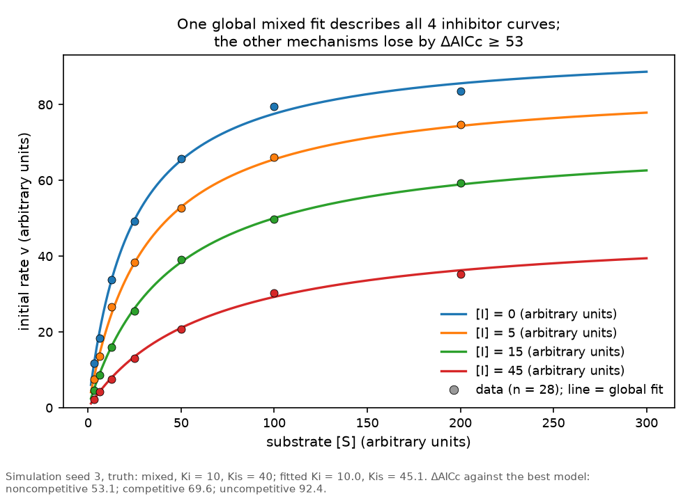

*One global mixed fit describes all four [I] curves; the other mechanisms lose by ΔAICc ≥ 53.*

## Worked example

```
model: michaelis_menten   n=8   s=2.767   R2=0.9929   AICc=20.38
    vmax = 98.0 +/- 2.91  (3.0%)
      km = 25.5 +/- 2.48  (9.7%)
  bootstrap 95% CI vmax: [93.2, 102.6]
  bootstrap 95% CI km:   [21.6, 29.9]
```
True values were Vmax = 100, Km = 25. Lineweaver-Burk on the same data gave Vmax = 95.0, Km = 23.5.

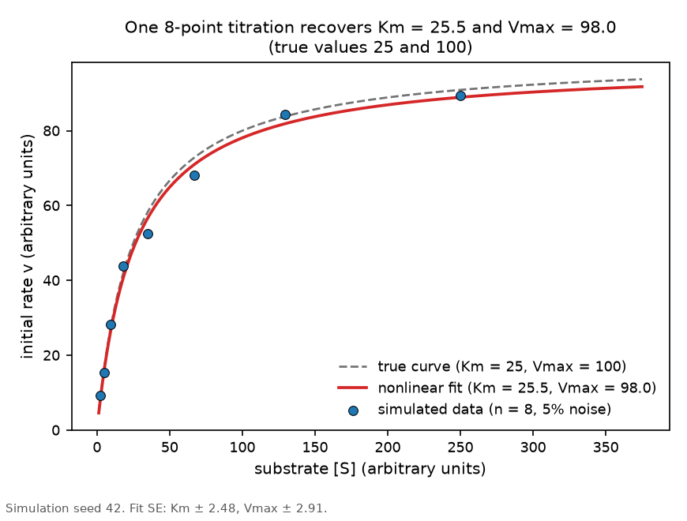

*One 8-point titration recovers Km = 25.5 and Vmax = 98.0 (true 25 and 100).*

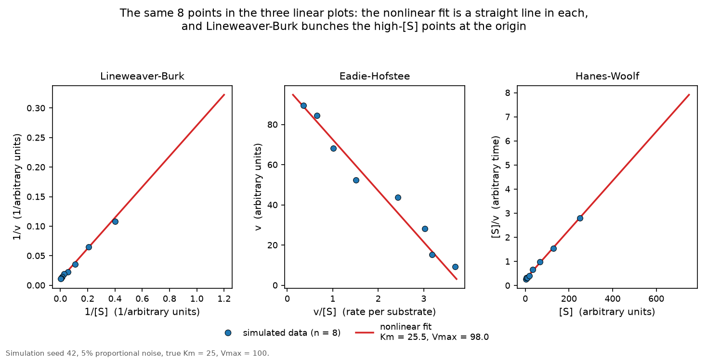

*The same points in the three linear plots: the nonlinear fit is a straight line in each, and Lineweaver-Burk bunches the high-[S] points at the origin.*

Mixed inhibition example, true Ki = 10 and Kis = 40:

| model | AICc | ΔAICc |
|---|---|---|
| mixed | 2.05 | 0.00 |
| noncompetitive | 55.12 | 53.08 |
| competitive | 71.66 | 69.61 |
| uncompetitive | 94.47 | 92.42 |

Recovered Ki = 10.0 ± 0.7 and Kis = 45.1 ± 3.1. A ΔAICc below about 2 is not evidence for one mechanism over another; `compare_models` returns the full ranking so this stays visible.

## Usage

```python
from enzkin import fit_michaelis_menten, compare_models

fit = fit_michaelis_menten(S, v)
print(fit.summary())
print(fit.ci95("km"))

results = compare_models(S, I, v)      # ranked best first by AICc
print(results[0].model, results[0].params)
```

## Layout

```
src/enzkin/   models (rate laws) · fitting (NLS, SE, AICc, bootstrap) · progress (integrated rate equation, Lambert W)
              linearize (the three classic transforms) · cheng_prusoff (IC50 <-> Ki, 4PL, assumption checks)
              pairing (IC50/Ki joins and the ratio test) · structure (PDB geometry)
              qsar (RDKit 2D descriptors, LOOCV, permutation null) · datasets (Frere 2023 traces, ChEMBL tables)
              simulate · plotting (library helpers; figures/ is written only by scripts/make_figures.py)
scripts/      make_figures.py        every figure in figures/ (the only figure writer)
              validate_fits.py       the simulation study behind the tables above
              sim_checks.py          what the Lineweaver-Burk SD is made of; which model wins in the mechanism study
              prepare_frere2023.py, fit_published.py       published traces: extract, then initial rates vs progress curves
              fetch_chembl_dhfr.py, ic50_to_ki.py, validate_cheng_prusoff.py     IC50/Ki tables, the conversion, the test against measured Ki
              ki_to_structure.py, fetch_chembl_smiles.py, qsar_congeneric.py, qsar_single_scaffold.py, qsar_tail_sweep.py     structure-affinity
tests/        286 tests: limiting cases on the rate laws, parameter recovery, CI coverage, mechanism identification,
              progress-curve recovery, Cheng-Prusoff limits and round trips, IC50/Ki pairing on the real ChEMBL tables,
              PDB geometry, descriptors against textbook constants, Spearman/LOOCV against SciPy, the permutation null
              on data with and without signal, and every figure reproducible from its artefact
```

## Reproducing

About 4 minutes on one CPU core end to end (Linux, Python 3.12): the suite about 45 s, `fit_published.py` about 80 s, `sim_checks.py` about 15 s, the figures about a minute.

```
python -m venv .venv
. .venv/bin/activate                 # Windows: .venv\Scripts\activate
pip install -r requirements.txt     # the exact versions the suite passed with
pip install -e . --no-deps
python -m pytest                     # about 45 s
python scripts/validate_fits.py      # print the simulation tables and the mechanism table
python scripts/sim_checks.py         # results_sim_checks.txt, about 10 s
python scripts/fit_published.py      # the P99 fits, the trace bootstrap and the window sweep, about 80 s
python scripts/make_figures.py       # regenerate figures/
```

`requirements.txt` pins the versions the suite and every committed artefact were checked with; `pyproject.toml` keeps lower bounds (`pip install -e ".[all]"` installs from those). The simulation tables depend only on NumPy's seeded generator and SciPy's least squares, and reproduce to every printed digit on Linux with Python 3.12, NumPy 2.5 and SciPy 1.18.

With the lower bounds, RDKit (the descriptor analysis only) is an optional extra, `pip install -e ".[qsar]"`, because it is a large binary wheel and nothing else here needs it. Its tests skip when it is absent, except `test_rdkit_is_installed_so_the_descriptor_tests_actually_run`, which fails, so a green run cannot mean the descriptor layer never ran; the statistics in `tests/test_qsar.py` are tested against SciPy independently of it.

## What each planned item found, and what is still open

All six planned items are done, three of them only as far as the data allow; the
item-by-item record, including what stays open in the structure-affinity work, is in
[`docs/planned_items.md`](docs/planned_items.md).

### Something the published data forced

Two errors that simulation could never have produced, caught by reading the real records:

**The instrument's number format.** Later time values are written `1.008.333`, meaning 1.008333 min: a thousands dot on top of a decimal point. `float()` raises `ValueError` on it, the louder and safer failure; the subtler trap is `0.008333` one column over, which parses cleanly. The mis-parsed curve still fits Michaelis-Menten beautifully and returns a Vmax wrong by orders of magnitude, and no fit diagnostic flags it, so the parser strips the dot explicitly and `tests/test_datasets.py` pins the conversion.

**Mutants hiding in a Ki table.** Methotrexate appears five times in the ChEMBL Ki records for *E. coli* DHFR with values of 0.001, 0.021, 330, 2400 and 170000 nM: an 8.2-order-of-magnitude spread (6.4 without the largest record) on one compound. The records the mutant filter removes are point mutants, and only the assay description says so. The loader now filters on it (9 of the 266 Ki records are removed) and the structure comparison uses wild-type records only.

## Fitting the published dataset

`scripts/fit_published.py`, `scripts/prepare_frere2023.py`. The 136 MB archive lives outside git; the extracted traces are committed because the tests read them (21 files, 84 KB on disk: the 18 used here and 3 repeats of traces already present, which the loader excludes by name).

| method | Vmax (µM/min) | Km (µM) | kcat (s⁻¹) | Km rel. SE |
|---|---|---|---|---|
| initial rates, 15% window | 34.45 ± 2.32 | 33.98 ± 5.03 | 957 | 14.8% |
| progress curves, all points | 32.71 ± 0.10 | 29.57 ± 2.21 | 909 | **7.5%** |
| published literature | — | 25 | 780 | — |

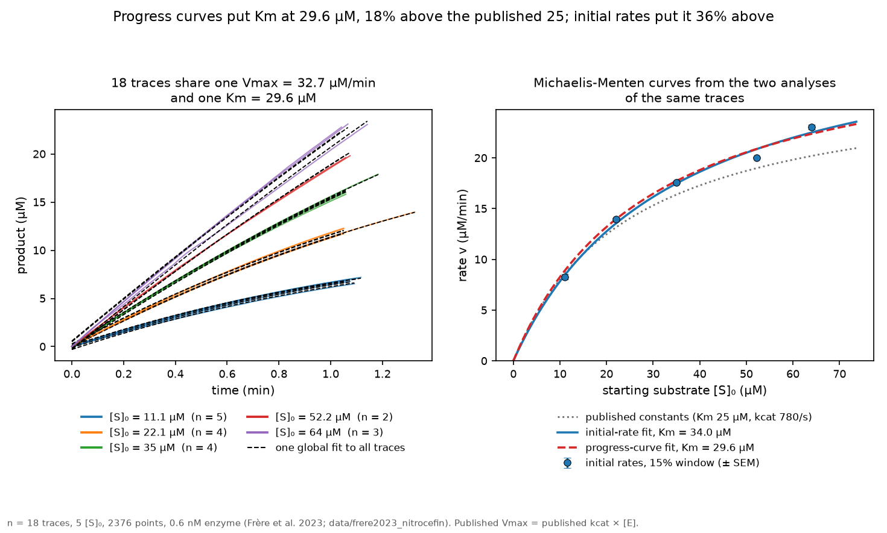

*Progress curves put Km at 29.6 µM, 18% above the published 25 µM; initial rates put it 36% above.*

The progress-curve SE is a **trace-level cluster bootstrap** (400 resamples, stratified by [S]₀): 95% CI for Km [25.74, 33.44] µM, with the published 25 µM just below it. Km lands within 18% of the published 25 µM and kcat within 17% of 780 s⁻¹. The i.i.d. SE the fit returns, 0.19 µM, is not an uncertainty and gives a Km SD about **12× too small**. The real gain over initial rates is the **Km SE, about 2× (5.03 → 2.21 µM), not 27×**: the 27× (5.03 / 0.185) is what the i.i.d. SE would claim, and it is wrong.

<details>
<summary>Why the i.i.d. SE fails, what the residual SD can and cannot say, and the Vmax gap</summary>

The i.i.d. number treats 2376 points from 18 traces as independent observations, but the residuals are strongly autocorrelated within a trace (lag-1 r 0.94 to 1.00 across all 18, median 1.00). Resampling whole traces is the level at which the data replicate. `progress.py` reports both and the per-trace lag-1 diagnostics; `cluster_se()` is in `scripts/fit_published.py`.

The residual SD of the progress-curve fit is 0.14 µM (`s` = 0.1413 in `results_published.txt`). `datasets.py` assumes an instrument resolution of about 1e-4 AU, about 0.007 µM of product at 15000 M⁻¹cm⁻¹ and 1 cm: an assumption written into the code, not a measurement from these files. Whatever the floor, that σ cannot be read as measurement noise or as evidence that the model is adequate: at lag-1 0.94–1.00 the residual is a smooth per-trace curve, systematic structure left in the fit (or slow drift), not independent scatter, and nothing here separates those. The only claim the fit supports is the bootstrap interval, which resamples whole traces and carries that structure into the uncertainty.

The curve shape constrains Km separately from Vmax and 18 traces beat 5 averaged rates. The two Vmax values differ by 5%, which is 0.75 of one initial-rate SE; the initial-rate window *could* include substrate depletion, but sweeping it from 5% to 40% moves Vmax from 35.24 to 34.99 with no trend (35.24, 35.07, 34.45, 34.50, 34.99 at 5, 10, 15, 25 and 40%; window table in `results_published.txt`), so the gap is not evidence of a depletion bias. `kcat` is 1.16× the published value, so `activation_fraction()` reports the preparation as 116% active rather than rescaling it away: a real preparation is not the literature preparation.

</details>

## IC50 to Ki

`scripts/ic50_to_ki.py` on 482 measured IC50 values for *E. coli* DHFR from ChEMBL (target CHEMBL1809, 353 compounds, 42 papers). The module refuses the mixed case (one IC50 cannot yield two Ki values) and flags the silent failures:

| [S]/Km | correction | what goes wrong |
|---|---|---|
| 0.1 | 1.1× | Km error barely matters |
| 2 | 3.0× | Km error carried 3× |
| 10 | 11× | a Km 30% too high moves Ki +27%; 30% too low, −28% |
| 50 | 51× | Km must be measured, not borrowed |

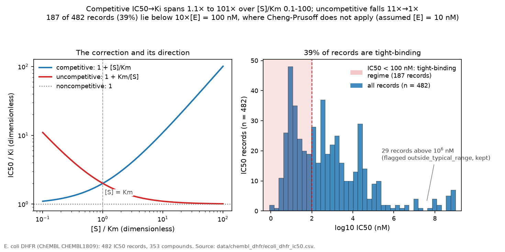

*The correction grows with [S]/Km, and 39% of the IC50 records sit below 10× an assumed 10 nM enzyme, where it does not apply.*

The tight-binding bound is the one that reorders series: at an assumed 10 nM enzyme, **39% of the 482 IC50 records (187; 35%, or 123 of the 353 compounds, by geometric-mean IC50) lie within 10× of [E]**, below 100 nM, where Cheng-Prusoff cannot be applied. There the plain conversion overestimates Ki by [E]/(2 (1 + [S]/Km)); the module warns.

### Is the conversion right? Measured against real Ki values

`scripts/validate_cheng_prusoff.py`: the *form* is **partially supported** and the *values* are untested. 52 compounds appear in both the IC50 and the Ki tables; for 35 both measurements come from the *same publication* (47 pairs, IC50 records of different stated [S] kept apart; 36 if pooled).

| set | n | median IC50/Ki | IQR | log10 SD |
|---|---|---|---|---|
| same publication (strict), IC50 kept apart by stated [S] | 47 | 9.38 | 4.50–18.98 | 0.409 |
| same molecule only (loose) | 52 | 6.89 | 3.99–20.25 | 0.534 |
| strict, IC50 pooled over [S] (the earlier join) | 36 | 7.47 | 6.61–20.58 | 0.407 |
| strict, sensitivity: excluding the 7 Ki records described as "antibacterial" | 40 | 9.99 | 4.75–20.25 | 0.418 |

The 95% bootstrap interval for the strict median is 5.08–11.05 if pairs are
treated as independent, and **4.25–20.50** with a cluster bootstrap over
the 6 assay-condition groups; the second is the one to read, because pairs
from one assay share its conditions, and with so few clusters it is coarse.
The 6 groups come from 5 papers: the two [S] groups of CHEMBL1136127 are the
same 11 compounds divided by the same 11 Ki values, so they are not
independent of each other, and neither this interval nor the ANOVA (in
`docs/planned_items.md`) accounts for that. A bootstrap over the 5 papers has not been run.
The loose join pairs across papers and has no within-paper structure to test;
its verdict is `not testable`.

The ANOVA, per-group slopes, two-substrate check and verdict rule with its threshold sensitivity are in the "Validating the conversion against measured Ki" item of [`docs/planned_items.md`](docs/planned_items.md), regenerated from `results_cheng_prusoff.txt`.

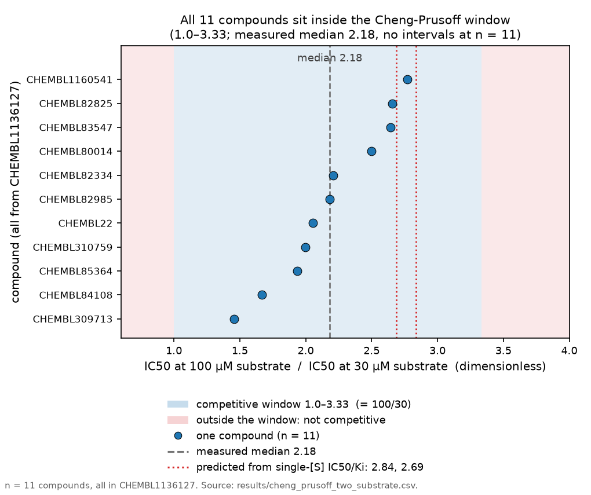

*All 11 compounds of the two-substrate paper sit inside the Cheng-Prusoff window (1.0–3.33), median ratio 2.18; the window is wide and n = 11 has no intervals.*

In short: within an assay condition the ratio is reproducible (pooled within-group log10 SD 0.288) and the conditions differ (F(4,41) = 12.86; figure under "At a glance"); two pairs sit below the competitive floor of ratio 1 and are kept; seven pairs use a Ki described as "antibacterial", an **unverified** label reported as a sensitivity analysis, not a deletion; and no [S] is stated for most assays, so the absolute conversion is untested compound by compound. `pairing.assay_residuals` would settle it given a paper that reports [S] and the assay Km.

## Ki to binding site

`scripts/ki_to_structure.py` on real coordinates of *E. coli* DHFR (1DDR, 3DAU, 4DFR), linked to measured Ki by the PDB chemical-component ChEMBL cross-reference. Methotrexate in the pocket (`results_structure.txt`):

| | 1DDR | 3DAU | 4DFR |
|---|---|---|---|
| site residues within 4.5 Å | 18 | 21 | 18 |
| ligand atoms in the 4.5 Å contact shell | 91% | 100% | 97% |
| hydrogen-bond atom pairs | 14 | 12 | 13 |
| salt-bridge atom pairs | 9 | 11 | 11 |

These count (protein atom, ligand atom) pairs under distance cutoffs, with no angle or charge check; the shell fraction is a contact count, not a strict van der Waals contact or a Shrake-Rupley SASA. Nor is this a structure-affinity relationship: the join gives 6 rows, one compound (methotrexate) with two wild-type Ki records against three coordinate sets of one protein, not independent observations, so any correlation would be anecdotal (the descriptor test below addresses that from another direction). Chain selection is a hazard: 4DFR contains both an *E. coli* and a *Lactobacillus casei* copy, and the wrong one would compare an *E. coli* affinity to the wrong protein while looking entirely normal.

## Structure-affinity, on the congeneric series that was already here

`scripts/qsar_congeneric.py`, `src/enzkin/qsar.py`: ten RDKit 2D descriptors against log10 Ki, leave-one-out cross-validation, and a **1000-shuffle permutation null** that refits the *entire* pipeline on a scrambled Ki vector (with 21 compounds and 11 fitted parameters, noise routinely produces an R² that looks like a finding). SMILES come from ChEMBL via `scripts/fetch_chembl_smiles.py` and are committed (11 KB), so the analysis runs offline.

| paper | n | des/param | Ki span | LOO R² | best single descriptor | p_perm |
|---|---|---|---|---|---|---|
| CHEMBL1123078 (J Med Chem 1985) | 21 | 1.9 | 0.021–16 nM (762×) | **−1.021** | HBD, 0.182 | 0.678 |
| CHEMBL1129627 (J Med Chem 1996) | 73 | 6.6 | 1.35–912000 nM | **0.326** | MW, 0.222 | ≤0.001 |
| CHEMBL1124156 (J Med Chem 1988) | 72 | 6.5 | 0.012–912000 nM | **0.624** | MW, 0.458 | ≤0.001 |

`p_perm` is floored at 1/(n_perm+1) = 0.001; on both larger series no shuffle reached the observed score.

**The tight series fails, and that is the informative result.** The 21-compound set (20 of 21 share a single Murcko scaffold) has LOO R² −1.021, worse than predicting the mean, p_perm 0.678, and its best univariate descriptor is not significant (|rho| ≤ 0.37, p ≥ 0.099). At 1.9 observations per parameter it **is too small to support a descriptor model**, and the fit is not reported as one.

**The plain answer:** a structure-affinity relationship is present in the 72–73 compound series and absent, indistinguishable from chance, in the 21-compound one. The constraint looks like sample size but the threshold is not located: n = 21 fails; n = 73 and 72, or their largest-scaffold subsets of 66 and 52, pass the null; nothing between 21 and 52 was tested, and the 1996 series loses its fit in the 1–100 nM band at n = 33.

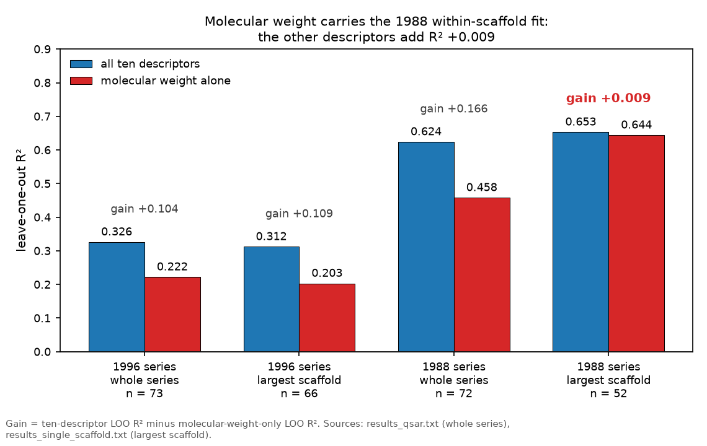

*Molecular weight carries the 1988 within-scaffold fit: the other descriptors add R² +0.009, against +0.104 to +0.166 in the other three cases.*

The limits that matter (every number is in the details below):

- **It depends on the potency range** (figure under "At a glance"): at Ki < 100 nM the 1996 fit is gone and the 1988 fit survives.
- **A single descriptor does most of the work**: molecular weight alone reaches 0.222 and 0.458, and ten descriptors add only +0.104 and +0.166. Bigger, more polar, more flexible compounds bind *better* here, which 2D descriptors cannot separate from hydrophobic contact area, so no coefficient is a design rule.
- **Neither result is a prediction about a new compound**: both describe variation inside a series that was already measured, by different groups on different days, with descriptors that cannot see the pose.

<details>
<summary>Tail sweep, permutation null, descriptor signs, and the scaffold restriction: every number</summary>

**Tail sensitivity depends on the cutoff and on the series.** Dropping only the compounds with Ki ≥ 100 µM (1 and 2 compounds) *raises* LOO R² to 0.582 and 0.736 (p_perm = 0.005 on 200 shuffles), so a few millimolar outliers do not carry the fit. But that is the mildest cut. Sweeping the cutoff downward (`scripts/qsar_tail_sweep.py`, `results_qsar_tail.txt`, 1000 shuffles): in the **1996 series** keeping only compounds below 100 nM leaves n = 33 and LOO R² = **−0.070** (best single descriptor 0.036, p_perm = 0.039), so the signal is absent in the drug-relevant band, and the largest scaffold goes to −0.143 (n = 29). In the **1988 series** the same cut leaves n = 25 and R² = **0.556** (best single descriptor 0.578, p_perm = 0.001; the ten descriptors do no better than one), and within the largest scaffold n = 21, R² = 0.873. So the signal is not tail-driven in the 1988 series and is, at a medicinal-chemistry cutoff, in the 1996 series.

**The permutation null is genuinely against us.** Shuffled R² on the 73-compound set: mean −0.201, 95th percentile −0.052, maximum 0.098, against 0.326 observed; on the 72-compound set: mean −0.215, 95th percentile −0.040, maximum 0.146, against 0.624.

**Descriptor signs.** Correlations are against log10 Ki (nM), so a *negative* rho means the descriptor raises affinity: bigger, more polar, more flexible compounds bind *better* here. In CHEMBL1129627 rho(MW, log10 Ki) = −0.532, MolRefract −0.436, HBA −0.352, TPSA −0.257, logP −0.207, RotB −0.118; the one exception is HBD at +0.064 (p = 0.59), so the direction is not uniform across descriptors, and CHEMBL1124156 repeats the pattern (MW −0.507, slightly weaker; RotB −0.516 and TPSA −0.417, stronger). A larger ligand binding tighter is consistent with a growing hydrophobic contact area rather than a size penalty, but 2D descriptors cannot tell the two apart, and logP itself is not significant in either series (rho −0.207, p = 0.078; −0.224, p = 0.058). The ten descriptors are MW, logP, TPSA, HBD, HBA, rotatable bonds, rings, aromatic rings, fraction Csp3 and molar refractivity (RDKit 2026.09.2). Source: `results_qsar.txt` (univariate Spearman blocks, both series).

**Scaffold restriction.** CHEMBL1124156 (the 1988 set) contains 9 Murcko scaffolds, so "congeneric" is generous there; that confound was tested and did not explain the result: restricted to its largest scaffold (52 of 72 compounds) the LOO R² is 0.653 against 0.624 for the whole set, p_perm = 0.001. What the restriction does show is that the fit is molecular weight and essentially only molecular weight (MW alone reaches 0.644, a +0.009 gain for the other nine descriptors), so the honest reading of that series is a molecular-weight (size/hydrophobicity) effect inside one chemotype, not a complementarity model. MW correlates negatively with log10 Ki, so the heavier compounds in this series bind tighter and this is not a penalty for being large. The 1996 set is the cleaner test, 66 of 73 on one scaffold, where the ten descriptors still add +0.109 over MW alone.

Outputs: `results_qsar.txt`, `results/qsar_series.csv`, `results_single_scaffold.txt` (the within-scaffold re-run).

</details>

## Note on how this was built

Written with substantial help from Claude (Anthropic) as a coding assistant. The scientific questions, the validation design, and the interpretation of the results are mine. The two findings that the simulation study turned up — that the Lineweaver-Burk critique depends on the assay's error model, and that the normal-approximation confidence intervals were overconfident at 87% coverage — both came out of deliberately testing the code against known answers rather than trusting that it worked.

## Corrections record

Statements changed in the review of 2026-11-17 (each change is in the commit history with its evidence):

| was | now | why |
|---|---|---|
| Km SD 6086% as the headline | spread 59% against 16% (IQR / 1.349) leads; 6086% kept, qualified | the sample SD has no finite limit: 1845% without one fit, 1088–11507% across seed blocks (`results_sim_checks.txt`) |
| Lineweaver-Burk fails "only" under absolute error | under the two error models, one design, that were run | nothing else was run |
| "the nonlinear fit is the only method never the worst" | withdrawn | Hanes-Woolf is never the worst either |
| "higher [S] is what breaks the tie" (mechanism table) | withdrawn | run, it does not: mixed wins 21, 16 and 15 of 100 at 32, 128, 512 × Km |
| noncompetitive row 100% | 100% stated as lenient; strict 84%, 84%, 85% | mixed was counted as correct |
| Vmax "about half a percent for four times the substrate" | 0.7 percentage points (2.9% to 2.2%) | recomputed |
| "not 25×" | 27× (5.03 / 0.185) | arithmetic |
| des/param 6.6 for n = 72 | 6.5 | 72 / 11 = 6.55 |
| MW −0.507 "more strongly" | slightly weaker than −0.532 | the number quoted is the smaller one |
| "18 extracted traces (84 KB) are committed" | 21 files, 3 of them excluded repeats | `ls data/frere2023_nitrocefin` |
| "paper-level cluster bootstrap (6 clusters)" | 6 assay-condition groups from 5 papers, dependence stated | two groups share one paper's compounds and Ki |
| "51% of the log-ratio variance" | stated as the adjusted share | `pairing.py` computes 1 − within/total variance, not η² |

No result number in a committed artefact changed. `results_published.txt` gained the window-sweep table the README already quoted, `results_sim_checks.txt` gained section (c), and `results_ic50.txt` changed its closing note's text only.

## Licence and third-party data

Code: MIT (`LICENSE`). The committed ChEMBL tables are CC BY-SA 3.0, the P99 traces CC BY 4.0 and the PDB files CC0; sources and terms are in [`NOTICE`](NOTICE).

## Part of a set

Six repos, one method: take the number a field reports, measure what a practitioner uses, publish
the gap.

- [admet-split-truth](https://github.com/Qwuantabee/admet-split-truth): does a validation split predict error on the next compounds?
- [mlip-fidelity](https://github.com/Qwuantabee/mlip-fidelity): do ML potentials rank near-degenerate conformers correctly?
- [epistasis-ceiling](https://github.com/Qwuantabee/epistasis-ceiling): do single-mutant effects add up on a double mutant?
- [variant-effect-prediction](https://github.com/Qwuantabee/variant-effect-prediction): does a cleaner assay target help zero-shot ESM-2?
- [single-cell-de](https://github.com/Qwuantabee/single-cell-de): are cells replicates?
- enzyme-kinetics: how wrong is a Lineweaver-Burk Km?

Overview: https://github.com/Qwuantabee
