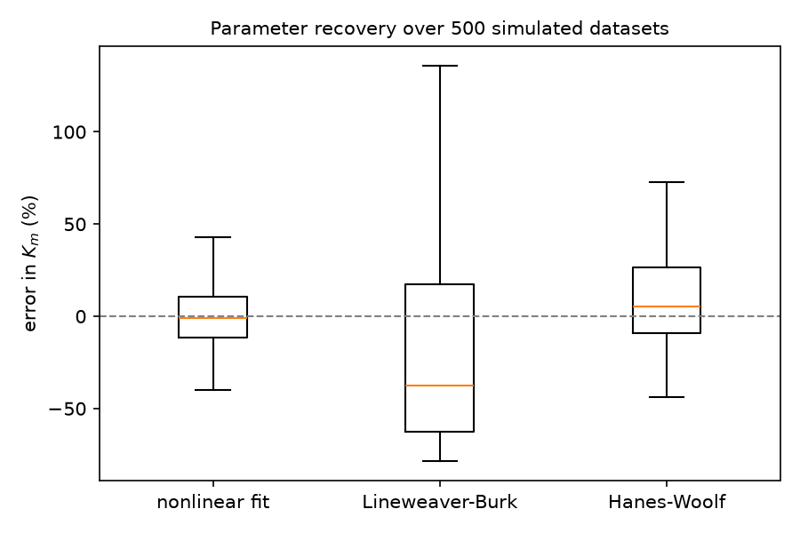
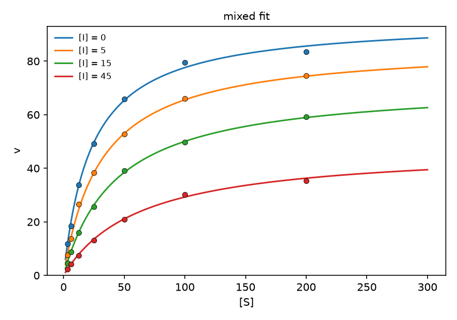

# enzkin — enzyme kinetics and inhibition analysis

Fitting Michaelis-Menten and inhibition models to initial-rate data, with
honest uncertainty estimates and mechanism assignment by AICc rather than by
eye.

Milestone 1 (this commit) is the modelling and fitting core, validated against
simulated data where the true parameters are known. Real published datasets
come next.

## Why not just use a Lineweaver-Burk plot

That was the original question behind this, and the answer turned out to be
more interesting than the textbook version.

The standard argument is that inverting `v` inflates the error on the low-[S]
points and wrecks the regression. Running it over 500 simulated datasets
(8 substrate concentrations, 5% noise, true Km = 25, Vmax = 100):

**Proportional error** (noise scales with the rate):

| method | Km bias | Km SD | Vmax bias | Vmax SD |
|---|---|---|---|---|
| nonlinear fit | +0.8% | 10.3% | +0.3% | 4.3% |
| Lineweaver-Burk | +0.1% | 11.1% | -0.0% | 6.9% |
| Hanes-Woolf | +0.8% | 11.0% | +0.2% | 5.0% |
| Eadie-Hofstee | -1.1% | **6.2%** | -0.5% | 3.5% |

**Constant absolute error** (noise independent of the rate):

| method | Km bias | Km SD | Vmax bias | Vmax SD |
|---|---|---|---|---|
| nonlinear fit | +1.0% | 18.2% | +0.3% | 5.5% |
| Lineweaver-Burk | -318% | **6086%** | -177% | 3302% |
| Hanes-Woolf | +17.6% | 228% | +2.3% | 29.9% |
| Eadie-Hofstee | -23.8% | 25.2% | -12.3% | 10.3% |

So the textbook warning is correct, but only under constant absolute error.
Under proportional error the transforms are fine, and Eadie-Hofstee was
actually the most precise of the four — the reciprocal happens to stabilise
proportional variance.

Which error model applies is a property of the assay, not of the algebra. A
continuous spectrophotometric assay reading a small absorbance change is
closer to constant absolute error, which is the regime where Lineweaver-Burk
falls apart. A discontinuous assay built on a dilution series or on counting
is usually closer to proportional.

The nonlinear fit is the only method that is never the worst choice, which is
why it is the default here. `weights="relative"` switches to proportional-error
weighting when that is what the assay has.



## Confidence intervals

The first version of `ci95` used ±1.96·SE. Over 500 simulated datasets those
intervals contained the true Km **86.8%** of the time while claiming 95%
(proportional-error simulation; 89.4% under constant absolute error —
reproduced by swapping 1.96 for the t value on the same 500 fits).

The cause is sample size: a typical run is 8 points and 2 parameters, so 6
degrees of freedom, where the right critical value is t = 2.45, not 1.96.
Switching to the t distribution raised coverage to **91.0%** (proportional
error) and **93.2%** (absolute error).

The remaining gap is real and is not a bug. Km and Vmax are bounded below at
zero and their sampling distributions are right-skewed, so a symmetric interval
cannot be exactly right. When the standard error is a large fraction of the
estimate, use `bootstrap_ci` instead, which resamples residuals and makes no
symmetry assumption.

## How far up the substrate range you need to go

Median relative standard error over 200 simulated runs, varying the highest
substrate concentration:

| max [S] | Vmax SE | Km SE | % of Vmax reached |
|---|---|---|---|
| 1 × Km | 7.7% | 12.3% | 50% |
| 2 × Km | 4.6% | 9.2% | 67% |
| 5 × Km | 2.9% | 7.8% | 83% |
| 10 × Km | 2.4% | 7.8% | 91% |
| 20 × Km | 2.2% | 8.1% | 95% |

Most of the benefit is gone by 5 × Km. Km is barely improved past that point,
and Vmax gains about half a percent for four times the substrate. Useful when
substrate is expensive or poorly soluble and you are deciding where to stop.

## Mechanism identification

All inhibitor concentrations are fitted together in one global fit rather than
fitting each [I] separately and watching how apparent Km and Vmax move. Models
are ranked by AICc (small-sample corrected, because these datasets are small
enough that plain AIC under-penalises the 4-parameter mixed model).

Fraction of 100 simulated experiments where the true mechanism was recovered,
on a 7 × 4 substrate-by-inhibitor grid:

| true mechanism | 2% noise | 5% noise | 10% noise |
|---|---|---|---|
| competitive | 85% | 85% | 85% |
| uncompetitive | 99% | 99% | 94% |
| noncompetitive | 100% | 100% | 100% |
| mixed | 100% | 100% | 84% |

Competitive sits at 85% regardless of noise, which says the failure is
structural rather than statistical: a mixed inhibitor with Kis much larger than
Ki is nearly indistinguishable from a pure competitive one, and no amount of
precision on this design separates them. Pushing to higher [S] is what breaks
the tie, since that is where the ES-binding term shows up.

Mixed is counted as correct when the truth is noncompetitive, because
noncompetitive is the Ki = Kis special case of mixed and nests inside it.



## Worked example

```
model: michaelis_menten   n=8   s=2.767   R2=0.9929   AICc=20.38
    vmax = 98.0 +/- 2.91  (3.0%)
      km = 25.5 +/- 2.48  (9.7%)
  bootstrap 95% CI vmax: [93.2, 102.6]
  bootstrap 95% CI km:   [21.6, 29.9]
```
True values were Vmax = 100, Km = 25. Lineweaver-Burk on the same data gave
Vmax = 95.0, Km = 23.5.

Mixed inhibition example, true Ki = 10 and Kis = 40:

| model | AICc | ΔAICc |
|---|---|---|
| mixed | 2.05 | 0.00 |
| noncompetitive | 55.12 | 53.08 |
| competitive | 71.66 | 69.61 |
| uncompetitive | 94.47 | 92.42 |

Recovered Ki = 10.0 ± 0.7 and Kis = 45.1 ± 3.1.

A ΔAICc below about 2 is not evidence for one mechanism over another.
`compare_models` returns the full ranking rather than just the winner so that
this stays visible.

## Usage

```python
from enzkin import fit_michaelis_menten, compare_models

fit = fit_michaelis_menten(S, v)
print(fit.summary())
print(fit.ci95("km"))

results = compare_models(S, I, v)      # ranked best first by AICc
print(results[0].model, results[0].params)
```

## Layout

```
src/enzkin/
    models.py      rate equations (MM, four inhibition models, Hill,
                   substrate inhibition) and kcat/efficiency
    fitting.py     nonlinear least squares, standard errors, AICc, bootstrap
    progress.py    integrated rate equation, Lambert W forward model
    linearize.py   the three classic transforms, for comparison
    cheng_prusoff.py  IC50 <-> Ki, 4PL dose-response fitting, assumption checks
    pairing.py     joins measured IC50 to measured Ki, tests the ratio
                   Cheng-Prusoff predicts against the ratio observed
    structure.py   PDB parsing, binding-site and contact geometry
    qsar.py        RDKit 2D descriptors, LOOCV, permutation null -- the
                   structure-affinity test on congeneric series
    datasets.py    the published traces (Frere 2023) and the ChEMBL tables
    simulate.py    synthetic data with known parameters
    plotting.py    figures
scripts/
    validate_fits.py       the simulation study behind every number above
    prepare_frere2023.py   extract the experimental traces from the archive
    fit_published.py       initial rates vs progress curves on real data
    qsar_single_scaffold.py  the QSAR signal inside the largest scaffold
    qsar_tail_sweep.py     the QSAR signal as the weakest binders are dropped
    ki_to_structure.py     Ki joined to the binding-site geometry
    fetch_chembl_dhfr.py   pull the IC50/Ki tables with assay descriptions
    ic50_to_ki.py          Cheng-Prusoff applied to the real IC50 series
    validate_cheng_prusoff.py  the conversion tested against measured Ki
    fetch_chembl_smiles.py canonical SMILES for the Ki compounds (cached)
    qsar_congeneric.py     2D descriptors vs Ki, with a permutation null
tests/             240 tests: limiting cases on the rate laws, parameter
                   recovery, CI coverage, mechanism identification,
                   progress-curve recovery, Cheng-Prusoff limits and
                   round trips, IC50/Ki pairing on the real ChEMBL tables,
                   PDB geometry on real structures, descriptors against
                   textbook constants, Spearman/LOOCV against SciPy, and
                   the permutation null on data with and without signal
```

## Setup

```
python -m venv .venv
.venv/Scripts/pip install -e ".[dev]"
.venv/Scripts/python -m pytest
.venv/Scripts/python scripts/validate_fits.py
```

The descriptor analysis is the one part that needs RDKit, which is an
optional extra (`pip install -e ".[qsar]"`) because it is a large binary
wheel and every other module here runs without it. The descriptor tests
skip when it is absent (one test, `test_rdkit_is_installed_so_the_descriptor_tests_actually_run`,
fails instead, so a green run cannot mean the descriptor layer never ran), and
the statistics in `tests/test_qsar.py` are otherwise independent of it:
they are tested against SciPy, which is already a dependency.

## Still to do

Updated after the published-data pass, the IC50/Ki validation, and the
congeneric-series descriptor test. None of the original items is still open;
three of them are done only as far as the available data honestly allows, and
what is left in those is written down rather than quietly dropped.

- ~~Fit published datasets rather than only simulated ones~~ — **done.**
  Eighteen experimental traces of *Enterobacter cloacae* P99 class C
  β-lactamase hydrolysing nitrocefin, from Frère, Verlaine & Matagne (2023),
  *Sci Rep* 13:14994, doi:10.1038/s41598-023-41805-y, archive CC-BY on Zenodo
  (doi:10.5281/zenodo.10059024). Five substrate concentrations from 11.1 to
  64 µM, 0.6 nM enzyme, 462 nm. See below.

- ~~Progress-curve fitting, to use the whole time course instead of initial
  rates~~ — **done.** The integrated rate equation is fitted to all 2376
  points. On these traces it puts Km within 18% of the published value with a
  Km standard error about 2× smaller than the initial-rate fit (5.03 → 2.21 µM,
  trace-level cluster bootstrap). See below.

- ~~IC50 to Ki conversion via Cheng-Prusoff, with the assumptions made
  explicit~~ — **done**, and the caveat that stood here is now measured
  rather than asserted. The relations, the assumption checks and a 4PL IC50
  fitter are in `cheng_prusoff.py`.

- ~~Validating the conversion against measured Ki~~ — **done, and the answer
  is that the *form* is partially supported and the *values* are untested.**
  This item used to say the check was impossible because ChEMBL records carry
  no assay [S] or [E] as fields. That is true for most assays, but it was too
  pessimistic about what *can* be tested. The two files in this repository
  overlap: of 482 IC50 records and 266 Ki records (257 wild-type), **52
  compounds appear in both**, and for **35 of them the IC50 and the Ki come
  from the same publication**. `scripts/validate_cheng_prusoff.py` joins them
  and tests the ratio the theory predicts, because Cheng-Prusoff for a
  competitive inhibitor says IC50/Ki = 1 + [S]/Km — a property of the assay,
  not of the compound. Every number below comes from
  `results_cheng_prusoff.txt` and `results/cheng_prusoff_ratio_stats.csv`.

  One publication (CHEMBL1136127) ran IC50 at two stated substrate
  concentrations, 30 and 100 µM (written in its assay descriptions). Pooling
  those IC50 records gives a ratio that belongs to neither assay, so the join
  now keeps them apart: **36 pooled pairs become 47**, 22 of them (11
  molecules) from that publication.

  | set | n | median IC50/Ki | IQR | log10 SD |
  |---|---|---|---|---|
  | same publication (strict), IC50 kept apart by stated [S] | 47 | 9.38 | 4.50–18.98 | 0.409 |
  | same molecule only (loose) | 52 | 6.89 | 3.99–20.25 | 0.534 |
  | strict, IC50 pooled over [S] (the earlier join) | 36 | 7.47 | 6.61–20.58 | 0.407 |
  | strict, sensitivity: excluding the 7 Ki records described as "antibacterial" | 40 | 9.99 | 4.75–20.25 | 0.418 |

  The 95% bootstrap interval for the strict median is 5.08–11.05 if pairs are
  treated as independent, and **4.25–20.50** with a paper-level cluster
  bootstrap (6 clusters); the second is the one to read, because pairs from one
  paper share an assay, and with so few clusters it is coarse.

  The median ratio of 9.4 implies a typical [S]/Km of 8.4 — but that pooled
  number averages assay conditions whose own medians are 3.0, 4.2, 4.6, 9.7
  and 20.9, so it is a summary and not a conversion factor. What the data can
  support is the *structure*: inside each assay condition the ratio is
  reproducible to a pooled within-group log10 SD of 0.288 (1.9-fold), and the
  groups differ from each other (one-way ANOVA, F(4,41) = 12.86,
  p = 7.2×10⁻⁷; 51% of the log-ratio variance is between groups). That is the
  pattern a per-assay substrate factor predicts, and any per-assay systematic
  difference would predict it too, so it does not single out Cheng-Prusoff.
  The label `partially supported` is decided by `pairing.verdict` from fixed
  thresholds; it is sensitive to the 0.30 limit on the within-group SD, and
  with a limit of 0.25 the same data would be labelled `unsupported`. The
  largest paper (CHEMBL3632554, 14 compounds spanning 1150 to 1.55×10⁶ nM of
  IC50) has a ratio-vs-potency slope of −0.025 with a 95% interval of
  −0.070 to 0.020. All four groups with at least five pairs have slope
  intervals that include 0, which is the absence of a detected trend, not
  evidence of none: the ratio is the difference of two log potencies, so
  independent noise biases the IC50 slope upward and the Ki slope downward,
  and the groups hold 7–14 points. The loose join pairs across papers and has
  no within-paper structure to test; its verdict is `not testable`.

  The two-[S] publication allows a direct (1 + [S]/Km) check that needs no
  Ki. For 11 compounds the IC50 at 100 µM over the IC50 at 30 µM has median
  2.18 (range 1.45–2.77); Cheng-Prusoff bounds it between 1 and 3.33. The
  single-condition IC50/Ki ratios imply Km medians of 8.1 µM (30 µM
  condition) and 11.4 µM (100 µM condition), which would predict a ratio
  of 2.84 or 2.69 against the 2.18 measured; the Km from the IC50 pair alone
  has median 29.2 µM and is noisy. These are measured medians without
  intervals at n = 11.

  What it does not support is the *values*. For most assays no [S] is stated,
  so no pair can confirm the correction it implies; any ratio above 1 is
  consistent with some substrate concentration. Two pairs sit below the
  competitive model's floor of ratio 1 (CHEMBL82985 at 0.48, CHEMBL1162149 at
  0.90) and are kept, not dropped. Seven pairs use a Ki whose ChEMBL assay
  description says "Antibacterial activity against Escherichia coli". That
  label is **unverified**: its Ki values (0.4–1.7 nM) are of the size of enzyme
  Ki, and trimethoprim's value there (1.3 nM) is within 5% of the value in 4 of
  the other 6 documents. They are flagged `antibacterial_described`, kept in the
  headline number, and reported as a sensitivity analysis. 29 of the 482 IC50
  records are above 10⁶ nM, a range ChEMBL itself flags (all report
  `standard_units` nM, so a units filter alone cannot catch them); they are
  flagged `outside_typical_range`, one of them is in a strict pair, and dropping
  it moves n from 47 to 46 and the median from 9.38 to 9.31. Validation of the
  absolute conversion still needs a paper carrying [S] alongside IC50 and Ki;
  `pairing.assay_residuals` is the function that would run that check.

- ~~Link Ki values to binding-site structure from the PDB~~ — **done**, and
  deliberately limited. Measured Ki values are joined to crystal structures
  via the PDB's chemical-component ChEMBL cross-reference, and the pocket is
  described from coordinates.

- ~~Structure-affinity relationship~~ — **done, and the answer is both yes and
  no, depending on which series.** The claim that stood here (that one protein
  with two ligands cannot support a relationship, and that it needs a
  congeneric series or mutagenesis data) was right about the requirement and
  wrong about the data: the congeneric series was already in the Ki table.
  Three papers in `data/chembl_dhfr/ecoli_dhfr_ki.csv` are single-assay
  congeneric sets, and they give two different answers. See below.

- **Open: what the two working series do not establish.** The signal is real
  against a permutation null and it survives restriction to a single Murcko
  scaffold (66 of 73 and 52 of 72 compounds, LOO R² 0.312 and 0.653, both
  p_perm = 0.001; `results_single_scaffold.txt`), which is evidence against
  its being pure chemotype spread, not a proof: within the scaffold the two
  ring-count descriptors are constant, so the fit uses eight descriptors, and
  a negative result there would not have shown the cause either. It is largely
  captured by molecular weight alone, and it is not independent of potency
  range: see the tail sweep below. What would settle the mechanism is a free-energy calculation
  against the actual 4DFR/1DDR poses rather than 2D descriptors, or a series
  whose congeners differ in a substitution the descriptors can resolve rather
  than in size. Neither is in the
  data here, and inventing a pose would be worse than the descriptor result.
  The other gap is coverage in the drug-relevant band. By Ki band
  (`results_qsar_tail.txt`): the 1996 series has 0 compounds below 1 nM, 33
  in 1–100 nM, 39 in 100 nM–100 µM and 1 at or above 100 µM; the 1988 series
  has 12 below 1 nM, 13 in 1–100 nM, 45 in 100 nM–100 µM and 2 at or above
  100 µM. So "the rest are weaker" is true of the 1996 series and false of the
  1988 series, where 12 compounds bind tighter than 1 nM. The 1985 series
  (0.021–16 nM) has 9 compounds below 1 nM and 12 in 1–100 nM.

### Something the published data forced

Two errors that simulation could never have produced, both caught by reading
the real records rather than trusting them:

**The instrument's number format.** Later time values in these files are
written `1.008.333`, meaning 1.008333 min — a dot used as a thousands
separator on top of a decimal point. `float()` raises `ValueError` on that
string rather than misreading it, which is the louder and safer failure; the
subtler trap is the value one column over, `0.008333`, which parses cleanly
while the trace's later timestamps are what actually carry the thousands dot.
Whatever the handling, the resulting curve still fits a Michaelis-Menten
model beautifully — it just returns a Vmax wrong by orders of magnitude.
Nothing in the fit diagnostics would have flagged it, which is why the parser
strips the spurious dot explicitly and `tests/test_datasets.py` pins the
conversion.

**Mutants hiding in a Ki table.** Methotrexate appears five times in the
ChEMBL Ki records for *E. coli* DHFR with values of 0.001, 0.021, 330, 2400
and 170000 nM. That looks like an 8.2-order-of-magnitude spread (6.4 orders if
the largest record is left out) on one compound. It is not: the records the
mutant filter removes are point mutants, and the only thing that says so is
the assay description. The loader now filters on it (9 of the 266 Ki records
are removed), and the structure comparison uses wild-type records only.

## Fitting the published dataset

`scripts/fit_published.py`, `scripts/prepare_frere2023.py`. The archive is
136 MB so it lives outside git; the 18 extracted traces (84 KB) are committed
because the tests read them.

Two analyses of the same 18 traces:

| method | Vmax (µM/min) | Km (µM) | kcat (s⁻¹) | Km rel. SE |
|---|---|---|---|---|
| initial rates, 15% window | 34.45 ± 2.32 | 33.98 ± 5.03 | 957 | 14.8% |
| progress curves, all points | 32.71 ± 0.10 | 29.57 ± 2.21 | 909 | **7.5%** |
| published literature | — | 25 | 780 | — |

The progress-curve SE is a **trace-level cluster bootstrap** (400 resamples,
stratified by [S]₀), not the i.i.d. value the fit returns: 95% CI for Km is
[25.74, 33.44] µM. The i.i.d. number, 0.19 µM, is not an uncertainty at all.
It treats 2376 points from 18 traces as 2376 independent observations, and
the residuals are strongly autocorrelated within a trace — lag-1 r runs 0.94
to 1.00 across all 18, median 1.00. Resampling whole traces is the level at
which the data actually replicate, and it gives a Km SD about **12× larger**
than the i.i.d. figure. `progress.py` now reports both, prints the lag-1
diagnostics per trace, and `cluster_se()` is in `scripts/fit_published.py`.

Km lands within 18% of the published 25 µM and kcat within 17% of 780 s⁻¹.
The residual standard deviation of the progress-curve fit is 0.14 µM
(`s` = 0.1413 in `results_published.txt`). `datasets.py` assumes an
instrument resolution of about 1e-4 AU, which is about 0.007 µM of product at
15000 M⁻¹cm⁻¹ and 1 cm; that resolution is an assumption written into the code,
not a measurement from these files. Whatever the floor, the residual σ cannot
be read as measurement noise or as evidence that the model is adequate:
with lag-1 autocorrelation at 0.94–1.00 the residual is a smooth per-trace
curve, so it is systematic structure left in the fit (or slow drift in the
traces), not independent scatter, and nothing here separates those. The only
claim the fit supports is the bootstrap interval above, which resamples whole
traces and so carries that structure into the uncertainty.

The real gain over the initial-rate fit is the **Km standard error, about 2×
(5.03 → 2.21 µM), not 25×**. The shape of each curve constrains Km separately
from Vmax and 18 traces beat 5 averaged rates, but the 25× figure came from
the i.i.d. SE and is wrong. Note also that the two Vmax values differ by 5%:
the initial-rate window *could* include substrate depletion, but this dataset
does not show it — the gap is 0.75 of one initial-rate SE, and sweeping the
window from 5% to 40% moves Vmax from 35.24 to 34.99 with no trend. The 5%
gap is not evidence of a depletion bias.

`kcat` is 1.16× the published value, so `activation_fraction()` reports the
preparation as 116% active rather than rescaling it away. A real preparation
is not the literature preparation.

## IC50 to Ki

`scripts/ic50_to_ki.py` on 482 measured IC50 values for *E. coli* DHFR from
ChEMBL (target CHEMBL1809, 353 compounds, 42 papers).

The module refuses the mixed case outright: one IC50 cannot yield two Ki
values. It also flags the three ways the conversion silently fails:

| [S]/Km | correction | what goes wrong |
|---|---|---|
| 0.1 | 1.1× | Km error barely matters |
| 2 | 3.0× | Km error carried 3× |
| 10 | 11× | a Km 30% too high moves Ki +27%; 30% too low, −28% |
| 50 | 51× | Km must be measured, not borrowed |

And the tight-binding bound, which is the one that reorders inhibitor series:
at an assumed 10 nM enzyme, **39% of the 482 IC50 records (187; 35%, or 123 of
the 353 compounds, by geometric-mean IC50) lie within 10× of [E]**, below
100 nM, and cannot be converted by Cheng-Prusoff at all. In that regime the
plain conversion overestimates Ki by [E]/(2 (1 + [S]/Km)); the module's
tight-binding warning says so.

### Is the conversion right? Measured against real Ki values

`scripts/validate_cheng_prusoff.py` answers the question the paragraph above
used to defer, and the answer is that the *form* is **partially supported**
and the *values* are untested. 52 compounds appear in both the IC50 and the Ki
tables; for 35 of them the two measurements come from the *same publication*,
which holds the lab and the protocol constant (47 pairs, with IC50 records of
different stated [S] kept apart; 36 if they are pooled). The table, the
cluster-bootstrap interval, the ANOVA, the per-group slopes with their
intervals, the two-substrate check and the verdict rule with its threshold
sensitivity are in the "Validating the conversion against measured Ki" item
under "Still to do" above, regenerated from `results_cheng_prusoff.txt`; they
are not repeated here so that the numbers live in one place.

In short: within an assay condition the ratio is reproducible (pooled
within-group log10 SD 0.288) and the conditions differ (F(4,41) = 12.86); two
pairs sit below the competitive floor of ratio 1 and are kept; seven pairs use
a Ki whose description says "antibacterial", which is an **unverified** label
reported as a sensitivity analysis rather than a deletion; and no [S] is
stated for most assays, so the absolute conversion is untested compound by
compound. Feeding [S] and the assay Km to `pairing.assay_residuals` is the
check that would settle it, and it needs a paper that reports both.

## Ki to binding site

`scripts/ki_to_structure.py` on real coordinates of *E. coli* DHFR
(1DDR, 3DAU, 4DFR), linked to measured Ki by the PDB chemical-component
ChEMBL cross-reference.

Methotrexate in the pocket, per structure (`results_structure.txt`): 18 site
residues in 1DDR, 21 in 3DAU and 18 in 4DFR within 4.5 Å; 91% (1DDR), 100%
(3DAU) and 97% (4DFR) of ligand atoms within the 4.5 Å contact shell (a
contact-count fraction, not a van der Waals contact in the strict sense); and
14 / 12 / 13 hydrogen-bond atom pairs with 9 / 11 / 11 salt-bridge atom pairs
in 1DDR / 3DAU / 4DFR. These are counts of (protein atom, ligand atom) pairs
under distance cutoffs, with no angle or charge check, not counts of distinct
interactions.

Two things this is not. It is not a Shrake-Rupley SASA calculation — burial is
a contact-count fraction. And it is not a structure-affinity relationship:
the join gives 6 rows, which are one compound (methotrexate) with two
wild-type Ki records laid against three coordinate sets of one protein, not
independent observations, so any correlation would be anecdotal. That
second gap is now addressed from a different direction, with 2D descriptors
rather than coordinates — see the next section. The chain-selection hazard is
real too: 4DFR contains both an *E. coli* and a *Lactobacillus casei* copy,
and picking the wrong one would compare an *E. coli* affinity to the wrong
protein while looking entirely normal.

## Structure-affinity, on the congeneric series that was already here

`scripts/qsar_congeneric.py`, `src/enzkin/qsar.py`. Ten RDKit 2D descriptors
(MW, logP, TPSA, HBD, HBA, rotatable bonds, rings, aromatic rings, fraction
Csp3, molar refractivity) against log10 Ki, with leave-one-out
cross-validation and a **1000-shuffle permutation null**. RDKit 2026.09.2.
SMILES come from ChEMBL's molecule endpoint via `scripts/fetch_chembl_smiles.py`
and are committed (11 KB) so the analysis runs offline.

The permutation null is the whole point, and it is not a formality. With 21
compounds and 11 fitted parameters, noise routinely produces the kind of R²
that looks like a finding. So each shuffle refits the *entire* pipeline —
standardisation, folds, least squares — on a scrambled Ki vector, and the
question is how often chance reaches the observed score.

| paper | n | des/param | Ki span | LOO R² | best single descriptor | p_perm |
|---|---|---|---|---|---|---|
| CHEMBL1123078 (J Med Chem 1985) | 21 | 1.9 | 0.021–16 nM (762×) | **−1.021** | HBD, 0.182 | 0.678 |
| CHEMBL1129627 (J Med Chem 1996) | 73 | 6.6 | 1.35–912000 nM | **0.326** | MW, 0.222 | ≤0.001 |
| CHEMBL1124156 (J Med Chem 1988) | 72 | 6.6 | 0.012–912000 nM | **0.624** | MW, 0.458 | ≤0.001 |

(`p_perm` is floored at 1/(n_perm+1) = 0.001; on both larger series no shuffle
reached the observed score, so the report says that rather than quoting the
arithmetic.)

**The tight series fails, and that is the informative result.** The
21-compound set — the most congeneric one, 20 of 21 compounds sharing a single
Murcko scaffold — has an LOO R² of −1.021, i.e. worse than predicting the
mean, with p_perm 0.678. Its best univariate descriptor does not reach
significance either (|rho| ≤ 0.37, p ≥ 0.099). With 1.9 observations per
parameter, this series **is too small to support a descriptor model**, and the
fit is not reported as if it were one.

The two ~72-compound series do show signal, and the honesty checks say it
survives them rather than evaporating:

- **Tail sensitivity: it depends on the cutoff and on the series.** Dropping
  only the compounds with Ki ≥ 100 µM (1 and 2 compounds) *raises* LOO R² to
  0.582 and 0.736 (p_perm = 0.005 on 200 shuffles), so the fit is not carried
  by a few millimolar outliers. But that is the mildest cut. Sweeping the
  cutoff downward (`scripts/qsar_tail_sweep.py`, `results_qsar_tail.txt`,
  1000 shuffles): in the **1996 series** keeping only compounds below 100 nM
  leaves n = 33 and LOO R² = **−0.070** (best single descriptor 0.036,
  p_perm = 0.039) — the signal is absent in the drug-relevant band — and the
  largest scaffold goes to −0.143 (n = 29). In the **1988 series** the same cut
  leaves n = 25 and R² = **0.556** (best single descriptor 0.578, p_perm =
  0.001; the ten descriptors do no better than one), and within the largest
  scaffold n = 21, R² = 0.873. So the signal is not tail-driven in the 1988
  series and is, at a medicinal-chemistry cutoff, in the 1996 series.
- **The permutation null is genuinely against us.** On the 73-compound set the
  shuffled R² distribution has mean −0.201, 95th percentile −0.052 and maximum
  0.098 against an observed 0.326; on the 72-compound set, mean −0.215, 95th
  percentile −0.040, maximum 0.146 against 0.624.
- **But a single descriptor does most of the work.** MW alone reaches 0.222 and
  0.458, and the ten-descriptor model adds only +0.104 and +0.166 over it. The
  sign of the correlation is against log10 Ki (nM), so a *negative* rho means
  the descriptor raises affinity: bigger, more polar, more flexible compounds
  bind *better* here. In CHEMBL1129627 rho(MW, log10 Ki) = −0.532,
  MolRefract −0.436, HBA −0.352, TPSA −0.257, logP −0.207, RotB −0.118; the
  one exception is HBD at +0.064 (p = 0.59), so the direction is not uniform
  across descriptors, and CHEMBL1124156 repeats the pattern more strongly
  (MW −0.507). A larger, more lipophilic ligand binding tighter is consistent
  with a growing hydrophobic contact area rather than a size penalty, but 2D
  descriptors cannot tell the two apart, so no individual coefficient should be
  read as a design rule. Source: `results_qsar.txt` (univariate Spearman
  blocks, both series).

So the plain answer, which the earlier README said could not be given: **a
structure-affinity relationship is present in the 72–73 compound series and
absent — indistinguishable from chance — in the 21-compound one.** The
binding constraint looks like sample size, but the threshold is not located:
the series tested are n = 21 (fails), and n = 73 and 72 or their largest-scaffold
subsets of 66 and 52 (pass the null); nothing between 21 and 52 was tested, and
the 1996 series loses its fit in the 1–100 nM band at n = 33.

Caveats worth stating rather than burying. The 1988 and 1996 papers are
QSAR-era datasets measured by different groups on different days, and 2D
descriptors cannot see the pose. CHEMBL1124156 (the 1988 set) contains 9
Murcko scaffolds, so "congeneric" is generous there — but that confound was
tested and did not explain the result: restricted to its largest
scaffold (52 of 72 compounds) the LOO R² is 0.653 against 0.624 for the whole
set, p_perm = 0.001. What that restriction does show is that the fit is
molecular weight and essentially only molecular weight (MW alone reaches
0.644, a +0.009 gain for the other nine descriptors), so the honest reading of
that series is a molecular-weight (size/hydrophobicity) effect inside one
chemotype, not a complementarity model. Note again the sign: MW correlates
negatively with log10 Ki, i.e. the heavier compounds in this series bind
tighter, so this is not a penalty for being large. The 1996 set is the cleaner test at 66 of 73 on one scaffold, where the
ten descriptors still add +0.109 over MW alone. Neither result is a prediction
about a new compound; both are descriptions of variation inside a series that
was already measured.

Outputs: `results_qsar.txt`, `results/qsar_series.csv`,
`results_single_scaffold.txt` (the within-scaffold re-run).


## Note on how this was built

Written with substantial help from Claude (Anthropic) as a coding assistant.
The scientific questions, the validation design, and the interpretation of the
results are mine. The two findings that the simulation study turned up — that
the Lineweaver-Burk critique depends on the assay's error model, and that the
normal-approximation confidence intervals were overconfident at 87% coverage —
both came out of deliberately testing the code against known answers rather
than trusting that it worked.
